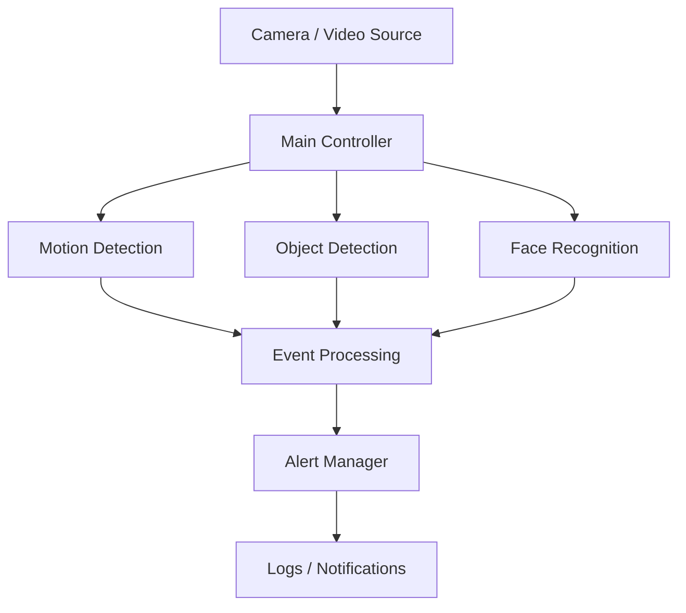

# 🛡️ AI Surveillance System

<div align="center">

### Intelligent Video Surveillance Using Python & Computer Vision

A modular AI-powered surveillance project designed to analyze video streams, detect motion, recognize known faces, identify objects, and manage security events through a centralized alert system.

[](https://www.python.org/)
[](https://opencv.org/)
[](#installation)
[](LICENSE)

**Developed by Vishal Kumar Yadav**

[Features](#-features) • [Architecture](#-system-architecture) • [Installation](#-installation) • [Usage](#-usage) • [Troubleshooting](#-troubleshooting) • [Roadmap](#-future-improvements)

</div>

---

## 📌 Overview

The AI Surveillance System is a Python-based computer vision project intended to assist with security monitoring by analyzing camera feeds or supported video sources.

The system is organized into independent modules so that detection algorithms, configuration settings, and alert handling can be maintained and improved separately.

### 🎯 Project Objectives

- Reduce dependence on continuous manual video monitoring.
- Detect movement in monitored environments.
- Identify objects using a compatible object detection model.
- Recognize enrolled faces when the recognition module is configured.
- Record relevant events and support security notifications.
- Provide a foundation for future intelligent surveillance applications.

## 🚀 Features

| Feature | Description |
|---|---|
| 🎥 Video Monitoring | Process a compatible live camera or video source. |
| 🏃 Motion Detection | Identify movement within the camera frame. |
| 🎯 Object Detection | Detect supported objects using a configured model. |
| 👤 Face Recognition | Compare detected faces with enrolled identities when configured. |
| 🚨 Alert Management | Centralize handling of detection events. |
| 📊 Event Logging | Record useful system events and detection results. |
| ⚙️ Configuration | Customize camera settings and detection parameters. |
| 🧩 Modular Design | Maintain detection and alert components independently. |

**Note:** Actual feature availability depends on the implementation and model files included in your repository. The README does not imply that every feature is already trained or enabled.

## 🧠 System Architecture



### Processing Workflow

1. Capture a frame from the selected video source.
2. Send frames to the configured detection modules.
3. Evaluate detection results against configured rules.
4. Pass relevant events to the alert manager.
5. Record events and issue configured notifications.

## 🛠️ Technology Stack

| Technology | Purpose |
|---|---|
| Python 3.11 | Application logic |
| OpenCV | Image and video processing |
| NumPy | Numerical and image-array operations |
| Face recognition libraries | Optional face identification |
| Object detection model | Optional object classification and localization |
| Git & GitHub | Version control and source hosting |

The exact packages required depend on the modules implemented in the project.

## 📂 Project Structure

```text
AI_Surveillance_System/
│
├── config/
│   └── Configuration files
│
├── utils/
│   └── Helper utilities
│
├── data/
│   ├── alerts/
│   ├── logs/
│   └── recordings/
│
├── models/
│   └── Model files
│
├── faces/
│   └── Enrolled face data, if configured
│
├── main.py
├── object_detector.py
├── motion_detection.py
├── face_recognizer.py
├── alert_manager.py
├── requirements.txt
├── .gitignore
└── README.md
```

**Important:** This is a suggested structure. Keep the filenames and folders consistent with the files that actually exist in your repository.

## ⚙️ Installation

### Prerequisites

- Python 3.11, 64-bit recommended on Windows.
- Git.
- Visual Studio Code or another Python editor.
- A compatible webcam or sample video for testing.
- Model weights and face data, if required by your implementation.

### 1. Clone the repository

```bash
git clone https://github.com/vishalyadav7091/AI_Surveillance_System.git
cd AI_Surveillance_System
```

### 2. Create a virtual environment

**Windows PowerShell:**

```powershell
py -3.11 -m venv venv
.\venv\Scripts\Activate.ps1
```

If PowerShell blocks activation, use Command Prompt instead:

```bat
venv\Scripts\activate.bat
```

**Linux / macOS:**

```bash
python3 -m venv venv
source venv/bin/activate
```

### 3. Upgrade installation tools

```bash
python -m pip install --upgrade pip setuptools wheel
```

### 4. Install dependencies

```bash
pip install -r requirements.txt
```

If installation fails, review the [Troubleshooting](#-troubleshooting) section before changing package versions.

### 5. Start the application

```bash
python main.py
```

The application will start only if `main.py`, the required modules, dependencies, model files, and configuration are available and correctly set up.

## ▶️ Usage

1. Connect a supported camera or prepare a test video.
2. Review the configuration file and camera index.
3. Ensure the required model weights and face data are present.
4. Activate the Python virtual environment.
5. Run `python main.py`.
6. Check the console output and configured log directory for events.

### Camera Configuration

For a local Windows webcam, OpenCV commonly uses camera index `0`.

```python
import cv2

camera = cv2.VideoCapture(0)

if not camera.isOpened():
    print("Error: Unable to open the camera.")
else:
    print("Camera connected successfully.")

camera.release()
```

Use the camera settings already defined by your project if it has a dedicated camera module.

## 🔍 Core Modules

### 🎯 Object Detection

Analyzes video frames to locate supported objects. Detection requires an implemented algorithm and, where applicable, compatible model weights.

Potential applications include restricted-area monitoring and identifying selected objects.

### 🏃 Motion Detection

Compares frames or uses a background-subtraction technique to identify movement.

Potential applications include intrusion alerts and activity monitoring.

### 👤 Face Recognition

Compares detected faces against enrolled face data when the necessary libraries, face encodings, and recognition logic are configured.

Recognition results should not be treated as definitive proof of identity.

### 🚨 Alert Management

Receives detection events and provides a centralized place to manage logging and configured notifications.

Email, messaging, and other external notifications require their corresponding integrations and credentials.

## 🧰 Troubleshooting

### Problem 1: `pip install -r requirements.txt` fails

Upgrade pip and retry:

```bash
python -m pip install --upgrade pip setuptools wheel
pip install -r requirements.txt
```

Check that your active interpreter is Python 3.11:

```bash
python --version
python -m pip --version
```

### Problem 2: `Failed building wheel for dlib`

Some Windows setups cannot build `dlib` without compatible build tools.

- Confirm that Python and the installed packages support your Python version and architecture.
- Review the installation instructions for the face-recognition library.
- Use a compatible, trusted prebuilt wheel if available for your exact environment.
- Do not download arbitrary DLLs or wheels from untrusted websites.

### Problem 3: `ModuleNotFoundError`

Activate your virtual environment and install the missing dependency:

```bash
python -m pip install package-name
```

Replace `package-name` with the actual missing package. If the import fails despite installation, verify that VS Code is using the correct Python interpreter.

### Problem 4: Camera is not opening

- Close other applications using the camera.
- Check Windows camera permissions.
- Verify the camera index.
- Test the camera independently using the OpenCV example above.

### Problem 5: `git push` fails

Check the configured remote and current branch:

```bash
git remote -v
git branch --show-current
git status
```

For HTTPS authentication, use Git Credential Manager or a supported personal access token workflow.

## 🔐 Security & Privacy

This project is intended for authorized security monitoring.

- Obtain appropriate consent where required.
- Restrict access to camera feeds, logs, and face data.
- Never commit API keys, email passwords, or `.env` files.
- Avoid uploading personal face images or recorded footage to a public repository.
- Apply suitable retention and deletion policies.
- Follow applicable privacy and data-protection laws.

## 🔮 Future Improvements

- [ ] Web-based monitoring dashboard
- [ ] Multiple camera support
- [ ] Configurable email and messaging alerts
- [ ] Database-backed event management
- [ ] Person tracking
- [ ] Restricted-area detection
- [ ] Improved anomaly detection
- [ ] Role-based access control
- [ ] Secure remote monitoring
- [ ] Docker deployment
- [ ] Automated testing and CI

These items represent potential improvements, not necessarily implemented features.

## 🤝 Contributing

Contributions and suggestions are welcome.

1. Fork the repository.
2. Create a feature branch.
3. Implement and test your changes.
4. Submit a pull request describing the changes.

## 📜 License

This project is intended to use the MIT License if the repository includes a corresponding `LICENSE` file. Add the actual license text before presenting the project as MIT-licensed.

## 👨‍💻 Author

**Vishal Kumar Yadav**

AI/ML Student | Python Developer | Computer Vision Enthusiast

- GitHub: [@vishalyadav7091](https://github.com/vishalyadav7091)

---

<div align="center">

### ⭐ Support the Project

If you find this project useful, consider starring the repository and sharing suggestions for improvement.

**Built with ❤️ using Python and Computer Vision**

</div>
